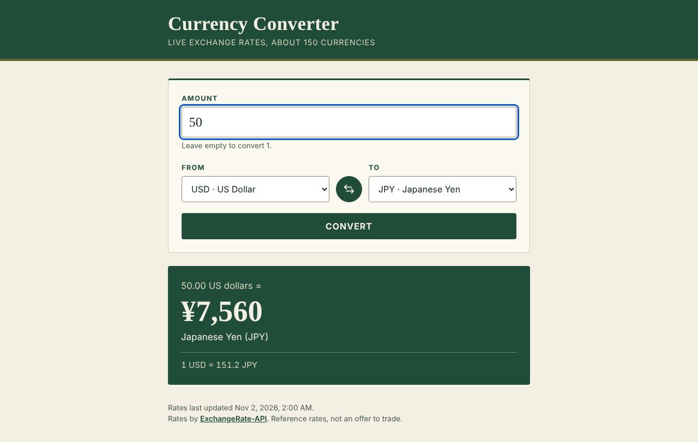
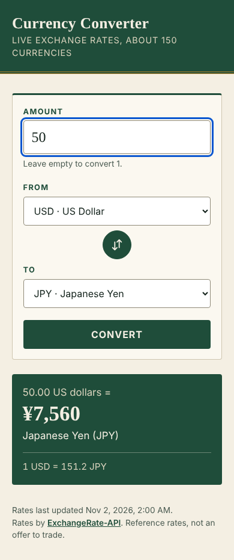

# Currency Converter

Convert between about 150 currencies using live exchange rates. Plain HTML, CSS and JavaScript, no framework, no build step.

Live demo: https://calculator-gie2.vercel.app

| Desktop | Mobile |
| --- | --- |
|  |  |

> The screenshots were taken with hand-made demo rates (the rates API cannot be reached from the sandbox they were produced in). They are not real market data.

## Features

- Amount, From and To fields with proper `<label>`s. Results update as you type, change a currency or press the swap button; the Convert button works too.
- Swap button exchanges the two currencies.
- Numbers are formatted with `Intl.NumberFormat` in the visitor's locale, using each currency's own decimals (JPY has none, KWD has three). Tiny results such as 1 IDR in USD keep their significant digits instead of rounding to 0.00.
- Amount parsing accepts `1250.5`, `1,234.56`, `1.234,56` and `12,5`; invalid input shows an inline message instead of a result.
- Clear loading, error and retry states. Errors are shown for network failure, request timeout (10 s), a rejected API key, a quota limit and a currency the service does not have. The result region is a polite live region.
- Rates are cached per base currency for 10 minutes. Your last From/To choice is remembered in `localStorage`.
- Currency names come from `Intl.DisplayNames`, with a built-in fallback list. No flag images and no external assets.

## Configuration (API key)

The rates come from ExchangeRate-API. Open `config.js`:

```js
const EXCHANGE_RATE_API_KEY = "";
```

- **Empty (default):** the app calls the free keyless endpoint `https://open.er-api.com/v6/latest/<CODE>`.
- **Set:** the app calls `https://v6.exchangerate-api.com/v6/<KEY>/latest/<CODE>`. A free key is available at https://www.exchangerate-api.com.

This is a static site, so a key placed in `config.js` is visible to every visitor. Use a free key you can rotate and do not put a paid key here. The original version of this project had a key hard-coded in `main.js`; it is still in the git history, so that key should be treated as public and rotated.

## Run it

```sh
python3 -m http.server 5253
# open http://localhost:5253
```

It deploys to Vercel as a static site with no build step.

## Tests

The parsing, conversion and formatting helpers live in `convert.js` and are covered with Node's built-in test runner (no dependencies):

```sh
node --test
```

11 tests cover amount parsing, rejecting bad input, per-currency decimals, tiny amounts, fallbacks and API error messages. A GitHub Actions workflow runs them on each push.

## Verification

Checked in headless Chromium with Playwright, with the rates endpoints answered by hand-made JSON through network routes: default load, typing an amount, swap, JPY and tiny IDR amounts, invalid input, a currency with no rate, a failed request followed by retry, and a rejected key (the key URL was checked with a fake value injected through a route, not committed). There were no console errors and no horizontal overflow at 1280px and 390px widths.

**Not verified:** calls to the real ExchangeRate-API endpoints. The sandbox cannot reach them, so the response shapes (`conversion_rates` for the keyed endpoint, `rates` for the keyless one) are based on the provider's documentation.

## Known limitations

- Reference rates only, refreshed by the provider about once a day on the free plans.
- The currency list is fixed; if the provider does not support a listed code, the app says so when you pick it.
- No chart, history or offline support.

## Notes

UI and code quality improvements were made with AI assistance (Claude, Anthropic), reviewed and verified by building and running the app.
